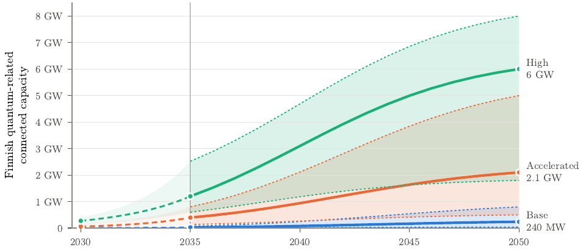
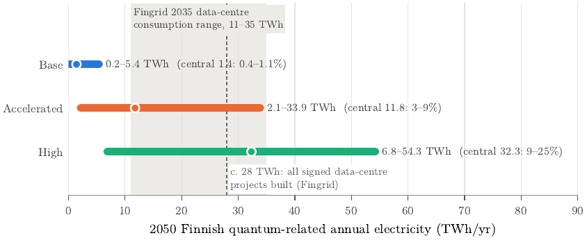

# Quantum Computing as an Emerging Electricity Load in Finland — Scenarios to 2050

[](https://doi.org/10.5281/zenodo.24014826)
[](https://creativecommons.org/licenses/by/4.0/)
[](LICENSE.txt)
[](https://doi.org/10.5281/zenodo.21966116)

**When does quantum computing stop being a grid-connection question and become a matter for the Finnish electricity system as a whole?**

This repository contains the paper source, scenario model and full outputs for *Quantum Computing as an Emerging Electricity Load in Finland: Scenarios to 2050 and Power-System Implications* (Merilehto, 2026; [doi:10.5281/zenodo.24014826](https://doi.org/10.5281/zenodo.24014826)). It extends the [2035 study](https://doi.org/10.5281/zenodo.21966116) to 2050. Quantum computing is treated as a full-stack facility load, not a qubit count: quantum hardware, cryogenic or optical environment, control, directly induced classical co-compute and dedicated infrastructure.

The capacities are **assumed deployment stress scenarios**, not forecasts or estimates derived from quantum workloads. The contribution is to show what each path would mean for the Finnish grid, and which assumptions decide it.

---

## Key results



Finnish quantum-related connected capacity and annual electricity (low / central / high paired states):

| Case | 2035 connected | 2050 connected | 2050 annual electricity |
|---|---|---|---|
| **Base** – hybrid integration | 5 / 26 / 72 MW | 40 / 240 / 800 MW | 0.20 / 1.41 / 5.43 TWh |
| **Accelerated** – commercial scaling | 135 / 396 / 800 MW | 0.5 / 2.1 / 5.0 GW | 2.1 / 11.8 / 33.9 TWh |
| **High** – FTQC scale-up, Finnish concentration | 0.6 / 1.2 / 2.5 GW | 1.8 / 6.0 / 8.0 GW | 6.8 / 32.3 / 54.3 TWh |

- **Materiality has a threshold.** Base stays at or below about 5% of any published national scenario. The Accelerated upper and High central states, at 32–34 TWh, would be 9–26% of Fingrid's 2045 scenario range (131–359 TWh). That is more than all Finnish data-centre projects with signed connection agreements in 2026 would use (about 28 TWh).
- **The endpoint follows targets, hosting and connection budget, but timing still matters.** A genuine 5- or 10-year deployment delay lowers the High central 2050 result by 17% or 48%.
- **Stickiness is a separate risk.** At the High upper capacity, raising the minimum-stable fraction from 25% to 78% lifts the operating floor from 1.8 to 5.5 GW at an unchanged 7.0 GW peak.
- **Rebound can be limited by the connection itself.** If half the curtailed energy is recovered, a 4-hour curtailment of the High upper span needs roughly 6–11 hours to recover within the available headroom.



---

## What the model does

1. **Retains the 2030 and 2035 states.** It reads them from the 2035 study's published parameter file (`data/inputs/`) and stops if it cannot reproduce that study's results exactly.
2. **Builds capacity from 2035 to 2050.** Nordic capacity grows toward a 2050 target along a logistic path, limited by an annual build rate, a commissioning lag and retirement. Orders already under way in 2035 are delivered.
3. **Hosts it in Finland.** Finnish capacity = min(hosting share × Nordic capacity, Finnish connection budget).
4. **Converts capacity to grid quantities.** Realised peak = C·r, minimum stable import = C·r·m, annual energy = C·r·ℓ·8760, with the invariants 0 ≤ m ≤ ℓ ≤ 1 checked before writing.
5. **Runs robustness tests:**
   - one-way sensitivity (tornado);
   - transition midpoint and a genuine (unrenormalised) delay;
   - operating-parameter drift;
   - a sticky-floor stress test;
   - curtailment recovery within connection headroom;
   - stalled construction (pipeline delivered or cancelled);
   - hosting share;
   - a top-down Nordic check;
   - an intensity check against present-system and fault-tolerant anchors.

---

## Repository layout

```
├── paper/
│   ├── main.tex            # manuscript (arXiv-style LaTeX)
│   ├── main.bbl            # compiled bibliography (arXiv needs it)
│   ├── references.bib
│   └── figures/            # figure PDFs used by the paper
├── model/
│   ├── model.py            # scenario model, standard library only
│   └── figures.py          # regenerates paper/figures/
├── data/
│   ├── inputs/             # 2035 study's parameter and results files, unchanged
│   ├── paths.csv           # annual 2035–2050 paths, every case and state
│   ├── results.csv         # 2030 / 2035 / 2040 / 2045 / 2050 results
│   ├── materiality.csv     # shares of national and data-centre references
│   ├── sticky.csv, recovery.csv, drift.csv
│   ├── tornado.csv, timing.csv, delay.csv
│   ├── stalled.csv, hosting.csv, topdown.csv, intensity.csv
│   └── pipeline_seeding.csv
├── docs/                   # README images
├── LICENSE.txt
└── CITATION.cff
```

## Reproduce

Windows PowerShell with conda, from the repository root:

```powershell
conda create -n qc2050 python=3.11 numpy pandas matplotlib -y
conda activate qc2050

python model\model.py        # writes data\*.csv; checks the 2030/2035 reproduction
python model\figures.py      # writes paper\figures\*.pdf
cd paper; latexmk -pdf main.tex
```

`model.py` uses only the Python standard library. The figures use Latin Modern if it is installed and fall back to the matplotlib default otherwise.

---

## Citation

```bibtex
@techreport{merilehto2026qc2050,
  author      = {Merilehto, Juhani},
  title       = {Quantum Computing as an Emerging Electricity Load in {Finland}:
                 Scenarios to 2050 and Power-System Implications},
  year        = {2026},
  institution = {Zenodo},
  doi         = {10.5281/zenodo.24014826},
  url         = {https://doi.org/10.5281/zenodo.24014826}
}

@techreport{merilehto2026qc2035,
  author      = {Merilehto, Juhani},
  title       = {Quantum Computing as an Emerging Electricity Load in {Finland}:
                 Scenarios to 2035 and Power-System Implications},
  year        = {2026},
  institution = {Zenodo},
  doi         = {10.5281/zenodo.21966116}
}
```

GitHub's **Cite this repository** button uses `CITATION.cff`.

## Licence

Paper text, figures and data: [CC BY 4.0](https://creativecommons.org/licenses/by/4.0/). Python code: MIT. See [LICENSE.txt](LICENSE.txt).

The analysis and views are solely the author's and do not represent any employer or affiliated institution.
